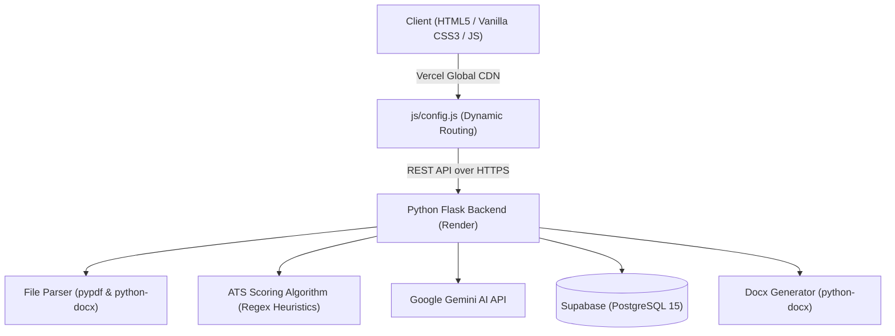

# Career Intelligence: AI Resume Analyzer & ATS Optimizer

[](https://vercel.com)
[](https://render.com)
[](https://supabase.com)
[](https://ai.google.dev/)

An enterprise-grade, full-stack AI Resume Analyzer and Applicant Tracking System (ATS) optimization platform. Evaluates candidate resumes against target job circulars using a **dual-engine architecture** (Deterministic Mathematical Heuristics + Google Gemini AI), calculates ATS compatibility scores, identifies skill gaps, and generates a professionally rewritten resume downloadable as an editable Microsoft Word (.docx) document.

---

## 🌟 Key Features

- **Dual-Engine Evaluation:**
  - **Deterministic Mathematical ATS Engine:** Evaluates standard section presence, power action verbs, quantifiable achievements, and target keyword frequency using explainable algorithms.
  - **Google Gemini AI Engine:** Deeply extracts technical competencies from raw job descriptions and generates a customized, recruiter-ready resume draft.
- **Multi-Format Resume Parser:** Seamlessly parses PDF and DOCX files extracting structured text.
- **Interactive Analytics Dashboard:** Real-time circular score meters, skill match color-coded chips, actionable improvement suggestions, and full review logs.
- **Dynamic Word (.docx) Export:** Generates cleanly styled Microsoft Word documents on-the-fly directly from memory.
- **User & Admin Portals:** Complete authentication system with live DNS email verification, role-based access control, analytics metrics, and CSV data export.
- **Responsive Enterprise UI:** Modern "Enterprise Royal Sapphire" design theme built with vanilla CSS variables without heavy dependencies.

---

## 🏗️ System Architecture & Tech Stack



| Layer | Technologies Used |
| :--- | :--- |
| **Frontend** | HTML5, Vanilla JavaScript (ES6+), CSS3 (Custom Variables, Flexbox/Grid), Hosted on **Vercel** |
| **Backend** | Python 3.11+, Flask, Flask-CORS, Gunicorn, Hosted on **Render** |
| **Database** | PostgreSQL 15 via **Supabase** (Row-level security, UUIDs, JSONB) |
| **AI & NLP** | Google Gemini Generative AI, PyPDF, Python-Docx, Email-Validator |

---

## 📁 Project Structure

```text
AI-Resume-Analyzer/
├── admin-dashboard.html    # Admin management & system analytics
├── admin-login.html        # Admin portal authentication
├── analysis.html           # Core resume intelligence & score display
├── dashboard.html          # Candidate profile & scan metrics
├── history.html            # Historical resume scans list
├── index.html              # Landing page & feature presentation
├── login.html              # User login with password recovery
├── register.html           # User signup with real-time email check
├── upload.html             # Drag & drop resume submission
│
├── css/
│   └── style.css           # Enterprise Royal Sapphire theme & responsive styles
│
├── js/
│   ├── config.js           # Central API endpoint configuration
│   ├── main.js             # Shared UI components, toasts, and modals
│   ├── auth.js             # Authentication workflows & session handling
│   ├── upload.js           # Multipart file upload handler
│   ├── analysis.js         # Result charts, badges, and export actions
│   ├── dashboard.js        # User metrics and history data binding
│   └── admin.js            # Admin analytics and user management
│
├── backend/
│   ├── app.py              # Flask server entry point
│   ├── config.py           # Database & environment initialization
│   ├── routes/
│   │   ├── auth.py         # Registration, login, validation endpoints
│   │   └── resume.py       # Upload, scoring, history, and export endpoints
│   └── services/
│       ├── algorithm.py    # Mathematical ATS calculation heuristics
│       ├── gemini.py       # Google Gemini AI circular extraction & rewrite
│       ├── parser.py       # PDF/DOCX text extraction engine
│       ├── docx_generator.py # In-memory formatted Word (.docx) builder
│       └── email_verifier.py # Live DNS MX and domain validator
│
├── requirements.txt        # Python production dependencies
├── Procfile                # Render process launch specification
├── render.yaml             # Render deployment blueprint
├── vercel.json             # Vercel static routing configuration
├── .vercelignore           # Excludes backend from static builds
└── START_SERVER.bat        # 1-click Windows local server runner
```

---

## 🚀 Local Development Setup

### 1. Clone the repository
```bash
git clone https://github.com/SK-Shishir/AI-Resume-Analyzer.git
cd AI-Resume-Analyzer
```

### 2. Configure Environment Variables
Copy `.env.example` to `.env` in the root and fill in your credentials:
```env
SUPABASE_URL=https://your-project.supabase.co
SUPABASE_SERVICE_KEY=your_service_role_key
GEMINI_API_KEY=your_gemini_api_key
SMTP_HOST=smtp.gmail.com
SMTP_PORT=587
SMTP_USER=your_email@gmail.com
SMTP_PASSWORD=your_app_password
```

### 3. Setup Python Virtual Environment
```bash
python -m venv .venv
# On Windows:
.\.venv\Scripts\activate
# On Linux/macOS:
source .venv/bin/activate

pip install -r requirements.txt
```

### 4. Start the Application
- **Windows:** Double-click `START_SERVER.bat` or run:
  ```bash
  python backend/app.py
  ```
- **Frontend:** Open `index.html` in your browser (or use VS Code Live Server at `http://127.0.0.1:5500`).

---

## 🔒 Security & Best Practices

- **Zero Plaintext Secrets:** Sensitive API keys and database credentials are strictly isolated via `.env` and `.gitignore`.
- **Password Protection:** Cryptographic hashing with salt (SHA-256) protects user credentials.
- **SQL Injection Prevention:** Parameterized and structured API queries through the Supabase client.
- **Resource Management:** In-memory file processing prevents persistent disk clutter on the host server.
